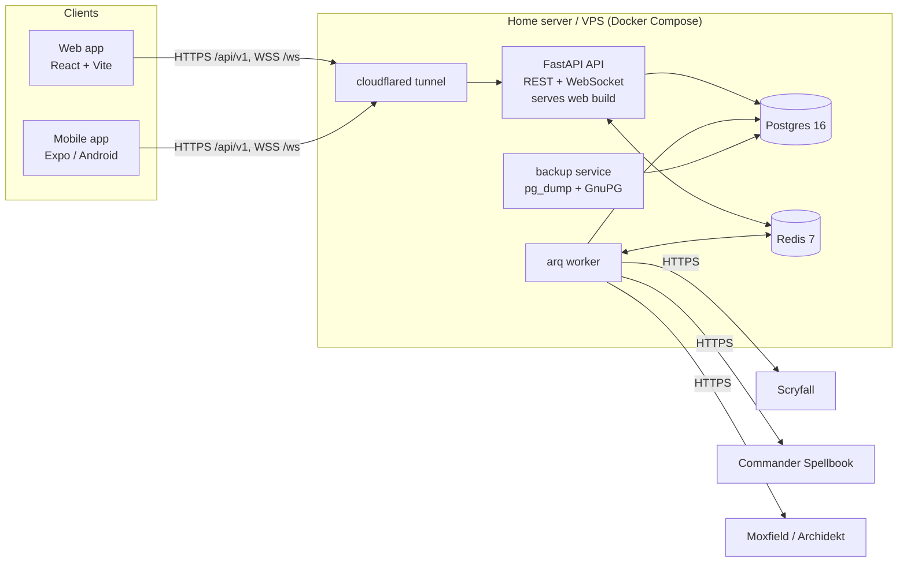
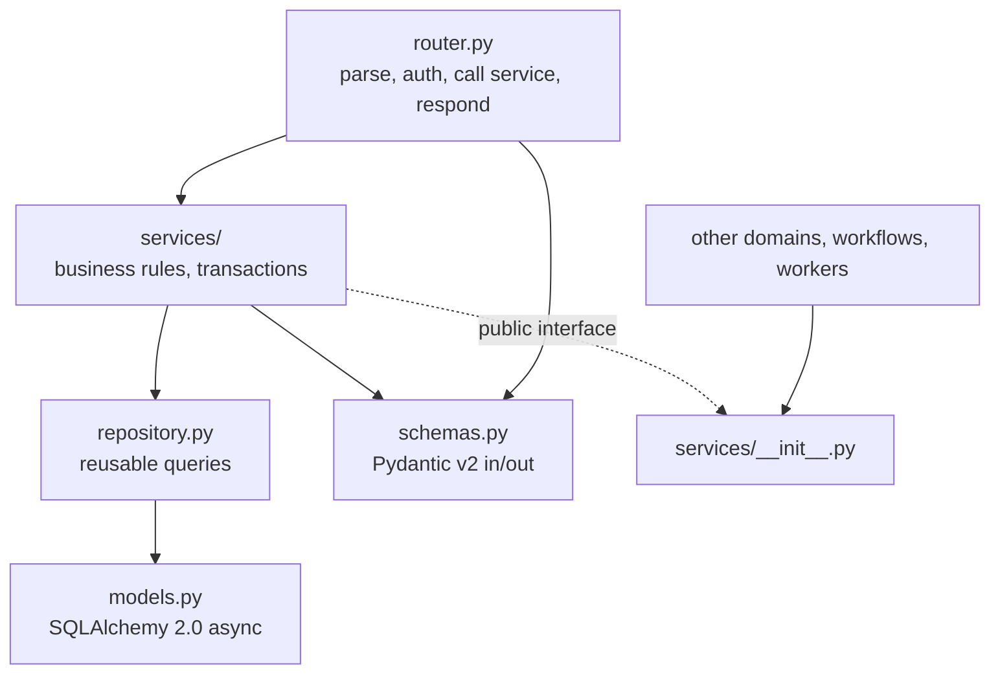
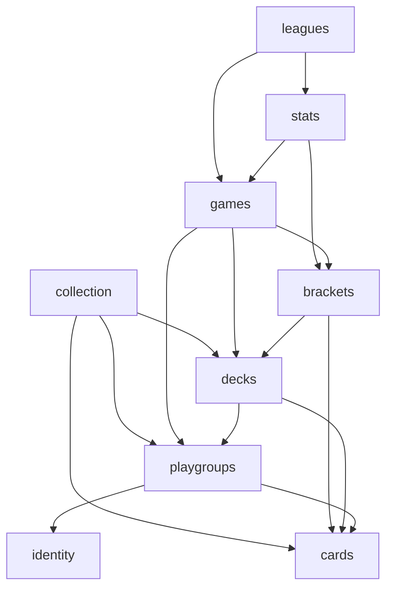
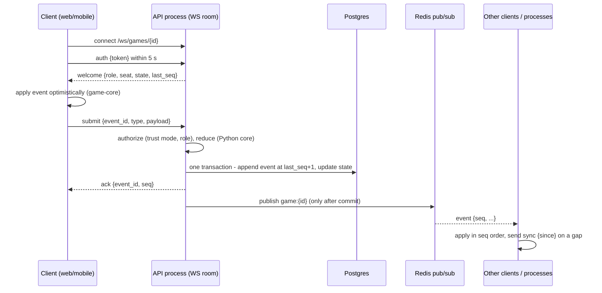
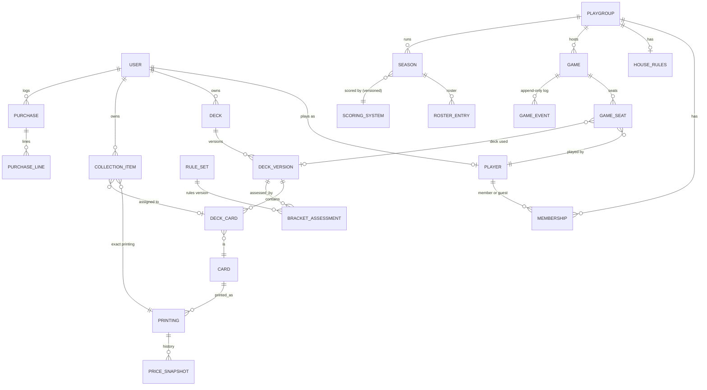

# MTG Stats — Architecture

Status: accepted (2026-11-07, revised after the PR #448 review). Owner: orchestrator. Changes go through an ADR in [`docs/adr/`](adr/).
Related documents: [plan](plans/mtg-stats-plan.md) · [decisions log](backlog/OPEN-QUESTIONS.md) · [CLAUDE.md](../CLAUDE.md)

## 1. System overview

MTG Stats is a companion app for a private Commander playgroup. One **FastAPI** service is the single authority for data and live game state. Two clients use it: a **React web app** and an **Expo mobile app**, both written in TypeScript and sharing packages. An **arq worker** runs background jobs. **Postgres** stores everything, and **Redis** carries job queues and fans live-game events out to every connected client.



iPhone users use the web app, which can be added to the home screen. Native builds are Android only for now; Apple will be revisited later (the "iPhone" decision, rounds 18–20).

## 2. Repository map

```
apps/
  api/                 FastAPI service + arq worker (one Python project, managed with uv; run uv commands here)
    app/
      core/            config, db session, ids (UUID v7), security (JWT encode/decode only), errors,
                       paging, links (public_link), jobs (enqueue by name), websocket hub, logging
      <domain>/        identity, playgroups, cards, decks, brackets, games, stats, collection, leagues
                       each: models.py, schemas.py, router.py, services/, repository.py, tests/
      workflows/       orchestration that spans several domains, with its own routers and jobs (§4.3)
      workers/         arq WorkerSettings, cron schedule, job registry
      main.py          app factory: routers, middleware, static web build
    migrations/        Alembic
    tests/             cross-cutting tests (architecture, API smoke, WebSocket soak)
  web/                 React + Vite + React Router + TanStack Query + Zustand; e2e/ (Playwright)
  mobile/              Expo + Expo Router + TanStack Query + Zustand; e2e/ (Maestro)
packages/
  api-client/          @mtg-stats/api-client: openapi-typescript types + an openapi-fetch client
  game-core/           TypeScript game reducer + vectors/ (JSON test vectors shared with Python)
  card-utils/          mana-cost parser, color identity, card formatting, legal/disclaimer text
infra/                 docker-compose.yml (api, worker, postgres, redis, cloudflared, backup, migrate),
                       deploy and backup scripts
docs/                  plan, backlog snapshot, architecture, ADRs, design notes, operations
```

Tooling: **uv** for Python, **pnpm workspaces** for TypeScript, and root `package.json` scripts that run both. `pnpm verify` runs the whole gate; `verify:api` and `verify:ts` run one half (S-1.8.1).

## 3. Backend layering



- **Routers** do no business logic. They validate input with schemas, resolve the current user, call one service function and return a schema.
- **Services** own transactions and permission checks beyond "logged in". They reach other domains only through those domains' public interfaces.
- **Unit of work**: a public service function accepts an optional caller `AsyncSession`. When it's given, the function joins the caller's transaction instead of opening its own. Workflows use this to span several domains in **one transaction**.
- **Repositories** hold the queries that are reused. Every list query eager-loads what it serializes.
- **Models** may carry behavior about their own fields (a fat model is fine). Workflows that touch several models belong in services.
- **No ORM event listeners** for business logic, and no implicit side effects. Follow-ups are explicit calls or enqueued jobs.

## 4. Domains

### 4.1 Domain catalogue

| Domain | Owns (main models) | Epics |
|---|---|---|
| `identity` | User, **Player** (one per user; guest players have no user), player profile and **profile privacy settings** (S-2.2.5), credentials (argon2id), refresh tokens and sessions, site admin role, user preferences (currency, time-zone override); auth dependencies (`current_user`, `require_site_admin`) | E-2 (F-2.1, F-2.2, F-2.3 player records) |
| `playgroups` | Playgroup, Membership (player, role: owner/admin/member/guest), Invite and invite suggestion, HouseRules (bans, allowances, game defaults), PlaygroupSettings (`time_zone`, `low_sample_games`, staples threshold), per-membership **financial sharing** (`financials_visible_to`) | E-2 (F-2.4, F-2.5) |
| `cards` | Card (`oracle_id`), Printing (Scryfall `id`, latest prices on every printing), Legality, PriceSnapshot, sync state | E-3 |
| `decks` | Deck, DeckVersion, DeckCard, import sources and cache, validation results, sorting-board drafts | E-4 |
| `brackets` | RuleSet (versioned), rule categories and card lists, BracketAssessment, Spellbook combo cache, bracket-change notices; also serves the **draft bracket preview** endpoint (S-4.7.5) | E-5 |
| `games` | Game, GameSeat, GameEvent (append-only), **guest game tokens** (S-2.3.2), results, result amendments (audit), spectators, join codes and QR | E-6 |
| `stats` | per-seat fact table, daily card aggregates, activity and meta queries, dashboard layouts and widget catalog | E-7, E-8 |
| `collection` | CollectionItem (exact printing), deck-copy assignments, Purchase and PurchaseLine, sealed openings, valuation | E-9 |
| `leagues` | Season, roster entries (join/leave times), scoring systems (versioned), standings, achievements, matchmaking; also serves the **season-filtered stats** endpoints (S-10.3.8) | E-10 |

`core/` isn't a domain. It holds shared plumbing only and **never imports a domain**. It decodes JWTs, but checking a user against the database happens in `identity`.

**How backlog names map to domains.** Some stories use other names:

| Name in stories | Domain |
|---|---|
| "players" domain, `players/services` | `identity` (Player, profiles, privacy); guest membership is in `playgroups` |
| "prices" domain | `cards` |
| "auth" / "accounts" | `identity` |
| "dashboard", "activity", "meta" | `stats` |

### 4.2 Allowed dependencies (cycles forbidden)

A domain may import the public `services` interface of any domain it can reach by **following the arrows**. The graph is transitive, so `games` may call `identity` through `playgroups`. Nothing else is allowed.



Arrows mean "may call", and they point **down** to lower layers. Some examples:
- `games` → `decks.services` gets a deck version for a seat.
- `games` → `brackets.services` freezes a seat's bracket at `game_started` (S-6.2.10).
- `decks` → `playgroups.services` reads house bans and allowances for validation.
- `playgroups` → `cards.services` resolves the card names on house-ban lists.
- `leagues` → `stats.services` reads recent win rates for matchmaking.
- `collection` → `playgroups.services` checks `financials_visible_to` before showing figures to someone else.

**Enforcement**: `apps/api/tests/architecture/test_domain_imports.py` computes the transitive closure of this graph. It fails on any import between domains that the closure doesn't contain, and on any import from a domain into `workflows/`. It extends S-1.4.6's boundary test, which checks that imports go through `services`.

### 4.3 Breaking would-be cycles

Each row is a need from the backlog that would otherwise require an upward call.

| Need | Story | Mechanism |
|---|---|---|
| Registration creates the User and Player and consumes the invite, in one transaction | S-2.1.3 | **Workflow** `workflows/registration.py`. It opens the transaction and passes the session to `identity` (User, Player) and then `playgroups` (consume the invite, create the membership). |
| A guest token must stop working after its game ends or is abandoned | S-2.3.2 | **Ownership**: guest game tokens live in `games`, which can see game state and can call `playgroups`/`identity`. |
| Invite non-members after a game | S-2.4.6, S-6.7.7 | **Inverted call**: the `games` router works out which seats are non-members and passes their player IDs to `playgroups.invite_status_for_seats` / `invite_after_game`. |
| Auth dependencies need the database | — | `core.security` only encodes and decodes JWTs. `current_user` and `require_site_admin` are in `identity.services`, which every domain may import. The guest or seat actor dependency is in `games`. |
| Price history only for printings that are owned or in a deck | S-3.4.2, S-3.4.3 | **Workflow job** `workflows.scryfall_daily_sync`. It asks `decks` and `collection` for the tracked printing IDs, then calls `cards.run_bulk_sync(tracked_printing_ids=…)`, which writes the snapshots in the same streaming pass. |
| A deck card's printing comes from the copy assigned to it | S-4.1.6, S-9.6.6 | **Job by name**: after a deck version is saved, `decks` enqueues `collection.claim_copies_for_deck`. Owned and priced printings are shown through `collection.effective_printings(deck_version)`, which may call `decks`. `decks` never imports `collection`. |
| Draft bracket preview on the sorting board | S-4.7.5 | **Ownership**: the endpoint is implemented by the `brackets` router (same URL) and calls `decks` for the draft and validation. |
| Bracket assessment when a deck version is saved | S-5.3.x | **Job by name**: `decks` enqueues `brackets.assess_deck_version`. |
| Results saved or amended must refresh stats and standings | S-6.7.4, S-6.7.6 | **Jobs by name**: `games` commits, then enqueues `stats.refresh_game_stats` and `leagues.recompute_for_game`. |
| A playgroup time-zone change must rebuild the card aggregates | S-2.4.7, T-7.5.1.4 | **Job by name**: `playgroups` enqueues `stats.rebuild_card_aggregates`. |
| Season filter on stats | S-10.3.8 | **Inverted call**: `stats` queries accept an optional `game_ids` filter. The season-filtered endpoints are in the `leagues` router, which passes `leagues.counted_game_ids(season)` to `stats`. |
| The profile spend widget shows collection figures | S-8.3.4 | **Client composition**: the widget calls `collection` endpoints, and `collection` checks the sharing setting through `playgroups`. |
| Merging a guest into an account moves seats, roster entries and stats | S-2.3.4 | **Workflow** `workflows/guest_merge.py` (`identity` → `playgroups` → `games` → `leagues`, then enqueues the stats rebuild). |
| Data export, account deletion, playgroup deletion | S-2.6.1–S-2.6.3 | **Workflow** `workflows/data_rights.py`. It calls each domain's `export_user_data` / `anonymize_user` / `delete_playgroup_data`. |

**Workflows**:
- Each workflow module may define its own FastAPI router, registered in `main.py`, and its own arq jobs. It may import any domain's `services`.
- No domain imports `workflows`.
- Jobs are named `<domain>.<job>` or `workflows.<job>`.

## 5. API conventions

- **Base path** `/api/v1`. The OpenAPI schema is generated by FastAPI, and `@mtg-stats/api-client` is regenerated from it (openapi-typescript + openapi-fetch). CI fails when the generated client drifts. Clients write their TanStack Query hooks by hand.
- **Auth** (S-2.1.x):
  - Login is by username and password.
  - The **access token** is a 15-minute JWT (PyJWT), sent as `Authorization: Bearer`.
  - The **refresh token** lasts 30 days and rotates on every use. On web it lives in an `HttpOnly`, `Secure`, **`SameSite=Strict`** cookie scoped to the auth routes, and never appears in a response body (S-2.1.5). On mobile it comes in the body and is stored in expo-secure-store.
  - Guests get **game-scoped tokens**, issued by `games`, valid until 24 h after the game ends or is abandoned, with a 7-day hard cap.
  - The site admin role is checked against the database on every request.
- **Errors** (S-1.4.5): every error (422, 401, 403, 404, 409, 429, 500) returns
  `{"error": {"code": "<snake_case>", "message": "<text>", "details": <object|null>, "request_id": "<id>"}}`.
  - `code` is stable (`forbidden`, `section_hidden`, `game_closed` …), and clients switch on it, never on `message`.
  - Validation errors go in `details`.
  - `request_id` also appears in the logs and the response headers. An unknown `/api/...` path returns this JSON 404 rather than the web app.
- **Paging** uses a cursor: `?cursor=<opaque>&limit=50` (max 200) and returns `{items, next_cursor}`. Keyset order is `(created_at, id)` unless an endpoint documents another order.
- **Time**: every timestamp is UTC (ISO 8601 with `Z`). Day and week boundaries use the effective time zone: the user's override, else the playgroup's. Weeks start on ISO Monday.
- **Money**: `{amount: "12.34", currency: "USD"}` as a decimal string. Each user picks one currency, USD or EUR, and nothing is ever converted.
- **Links** (S-1.6.7, which refines decision B6):
  - Shareable links are built on the server only, with `app/core/links.py` `public_link(kind, value)`, which returns `<PUBLIC_WEB_URL>/<kind>/<value>` for `invite`, `reset` and `join`.
  - The public pages show an `OpenInAppButton` that links to `mtgstats://<kind>/<value>` on mobile browsers.
  - The mobile app uses `mtgstats://` for in-app navigation.
  - Universal and App Links replace the button in Phase 5 (S-11.5.6). Native is Android only for now, so in practice that means Android App Links.
- **CORS**: only `CORS_ALLOWED_ORIGINS` (S-1.4.1). In `dev`, the web dev server origin is allowed.

## 6. Real-time game flow

### 6.1 Contract

- **Event envelope** (S-6.1.1): `event_id` (a UUID v4 generated by the client, which makes events idempotent), `game_id`, `seq` (assigned by the server), `type`, `payload`, `actor`, `on_behalf_of_seat`, `ts` (server UTC) and `v` (schema version).
- **Reducers**: `reduce(state, event) → state | error` is implemented twice, in `packages/game-core` (TypeScript) and `app/games/core/` (Python). Both are pure: no clock, no randomness and no I/O. Both must pass every file in `packages/game-core/vectors/` and produce **byte-identical canonical JSON**.
- **Storage** (S-6.3.1): `game_events` is append-only, with unique `(game_id, seq)` and `(game_id, event_id)`. The event row, `games.state` and `games.last_seq` are written in **one transaction**.
- **Undo** appends a compensating `event_reverted`. Corrections, such as fixing seats mid-game or amending results, are new events or audit rows. Existing rows are never edited.
- **Messages**:
  - Client to server: `auth`, `submit`, `sync`.
  - Server to client: `welcome`, `ack`, `reject`, `event`, `auth_expired`, `error`.

### 6.2 Flow



- **Rejections** reply `reject {event_id, code}`; nothing is stored or broadcast. A duplicate `event_id` returns the original `ack`.
- **Ordering**: clients apply events in strictly increasing `seq`. A gap triggers `sync {since}`. A client more than 500 events behind gets a snapshot instead.
- **Reconnect**: back off at 0.5, 1, 2 and 4 s, capped at 10 s, with jitter. After reconnecting, the client sends `sync`, then resends its pending local events with their original `event_id`s.
- **Heartbeat**: a ping every 15 s; a socket that misses replies for 30 s is closed.
- **Token expiry**: when the access token expires mid-game, the server sends `auth_expired` and refuses events. The client must re-authenticate within 30 s, or the socket closes with 4401.
- **Close codes**: 4401 means unauthenticated or auth expired, 4403 means not allowed in this game, 4404 means unknown game.
- **Trust modes** (D1): in `casual`, any seated player may change any seat. In `strict`, a player changes only their own seat and events they are the source of, and the host may change anything. Only the host can change settings, start, end, abandon or resume, correct seats or switch the control mode.
- **Fan-out** goes through Redis even with a single production instance. This keeps several uvicorn workers safe and is covered by the multi-process soak test (S-6.3.4).

### 6.3 After the game

Ending a game runs `game_ended`, then the host confirms the summary (which is auto-filled from the log), then results are saved in `games`. Saving enqueues `stats.refresh_game_stats` and `leagues.recompute_for_game`. When an admin amends a result, an audit row is written and the same jobs are enqueued again.

**Placements** use competition ranking (1, 2, 3, 3). In a full draw, `no_winner` is true and the survivors share placement 1 with outcome `draw`. Abandoned games never count in stats or leagues.

## 7. Background jobs

All jobs are **idempotent** and **enqueued by name** through `core.jobs.enqueue("<owner>.<job>", **kwargs)`. Every run writes a `job_runs` row (S-1.9.4), and `/api/v1/health/ops` reports stale or failed jobs to the uptime monitor. **Each job's name is defined by its owning story.** The table lists the main ones:

| Job | Trigger | Owner | Story |
|---|---|---|---|
| Daily Scryfall sync: streams the bulk files with ijson, upserts cards and printings, updates the latest prices on every printing, and writes snapshots for tracked printings in the same pass | daily, 09:00 UTC | `workflows` → `cards` | S-3.1.x, S-3.4.2, S-3.4.3 |
| `thin_price_snapshots`: thin history older than 2 years to weekly | weekly cron | `cards` | S-3.4.7 |
| `lookup_printings`: cached on-demand Scryfall lookups (including foreign-language printings) | on demand | `cards` | S-3.2.5 |
| Deck URL import fetch, plus the `preview_ready` notification | on demand | `decks` | S-4.2.x, S-4.3.x |
| `brackets.assess_deck_version` (includes the Spellbook query, 7-day cache) | deck version saved | `brackets` | S-5.2.x, S-5.3.x |
| Reassess decks and create notices when a rule set is published | rule set published | `brackets` | S-5.3.5 |
| `collection.claim_copies_for_deck` | deck version saved | `collection` | S-9.6.6 |
| Collection CSV import and valuation refresh | on demand / after sync | `collection` | F-9.2, F-9.5 |
| `stats.refresh_game_stats`: rebuild one game's fact rows | results saved or amended | `stats` | S-7.1.1 |
| `rebuild_stats`: full rebuild | weekly + CLI | `stats` | S-7.1.6 |
| `stats.rebuild_card_aggregates` | playgroup time-zone change | `stats` | T-7.5.1.4 |
| Rebuild games for merged players | guest merge | `workflows` → `stats` | S-2.3.4, S-7.1.7 |
| `leagues.recompute_for_game` | results saved or amended | `leagues` | F-10.3 |
| `abandon_idle_games`: lobbies idle for 2 h, games idle for 24 h | every 10 min | `games` | S-6.2.9 |
| Refresh-token cleanup, `job_runs` purge, worker heartbeat | daily / per minute | `identity`, `workers` | F-2.1, S-1.9.x |
| `db_backup`: **external** job. It runs in the Compose `backup` service (pg_dump + GnuPG), not in the arq worker | daily | infra | S-11.3.2 |

## 8. Domain model (overview)



## 9. Clients

- **Shared packages**:
  - `@mtg-stats/api-client`: generated types plus a configured openapi-fetch instance, with an `ApiError` that carries `code`, `message`, `details` and `requestId` (S-1.5.2).
  - `game-core`: the reducer, the event types and a sync engine that handles optimistic apply, reconcile by `seq`, pending-event resend and backoff.
  - `card-utils`: helpers and the Fan Content Policy disclaimer text.
- **Server state** lives in TanStack Query hooks per domain (`useDeck`, `useGameResults` …). **Client state** (table UI, drafts, the dashboard layout before it is saved) lives in Zustand. **Live game state** comes from the game-core sync engine over the WebSocket, not from TanStack Query.
- **Web** uses React Router; dnd-kit for seats, damage and the sorting board; react-grid-layout for the dashboard; and Recharts for charts. The public `/invite`, `/reset` and `/join` pages render the `OpenInAppButton`.
- **Mobile** uses Expo Router (which handles `mtgstats://`); Gesture Handler and Reanimated for drag; victory-native for charts; expo-secure-store, expo-keep-awake and expo-haptics; and react-native-svg for mana symbols.
- **Links**: clients never build shareable `https://` links themselves. They use the URLs the API returns.
- **Accessibility**: every drag has a tap or keyboard alternative. These are listed in each story's acceptance criteria.

## 10. Deployment and operations (Phase 5)

- **Hosting**: one home server or VPS running Docker Compose with these services: `api`, `worker`, `postgres`, `redis`, `cloudflared`, `backup` (daily `pg_dump` with GnuPG encryption) and `migrate` (one-shot, runs `alembic upgrade head` before `api` starts). There are **no open ports**: traffic arrives through a Cloudflare Tunnel on the owner's domain. The single API container also serves the web build as static files. Images are stored in GitHub Container Registry.
- **Deploy**: the owner runs a deploy script over SSH, so GitHub holds no production credentials. There is production only, with no staging.
- **Backups**: daily, encrypted to the owner's GnuPG public key, kept 14 days, with a copy on a second disk or NAS. The recovery point is within 24 h, the restore target is 4 h, and there is a restore drill every quarter.
- **Observability**:
  - Structured JSON logs carrying `request_id` and game IDs, kept 30 days.
  - An admin page listing recent 5xx errors.
  - An external uptime monitor checking `/api/v1/health/ready` and `/api/v1/health/ops`. `/api/v1/health/live` is the container liveness check.
  - pip-audit and Dependabot in CI.
  - No Sentry and no EAS Update.

## 11. Cross-cutting rules

- **IDs**: UUID v7 from `app/core/ids.py`, a standard-library implementation because Python 3.12 has no `uuid7`.
- **Security**: argon2id password hashing; sign-in rate limiting (S-2.1.10, reused by S-11.6.2); CORS limited to `CORS_ALLOWED_ORIGINS`; secrets only in env and never in the repo; pre-commit secret checks, re-run in CI.
- **Privacy**: spend and collection value are private by default. Profile sections can be hidden. A deleted user's seats become "Deleted player".
- **External services** (Scryfall, Commander Spellbook, Moxfield, Archidekt) always get the User-Agent `MTGStats/<version> (+<repo URL>)`, caching and backoff. The app checks each site's terms before building against it.
