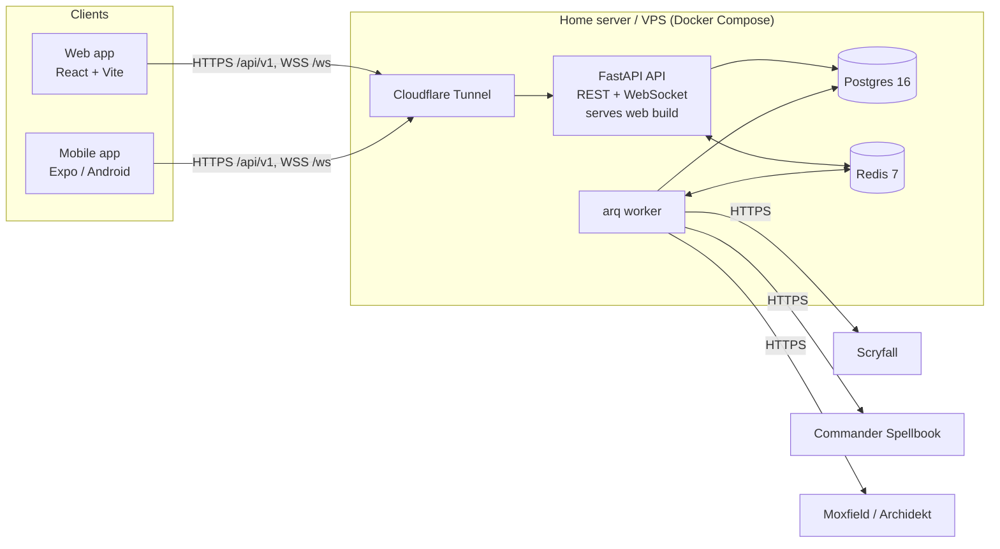
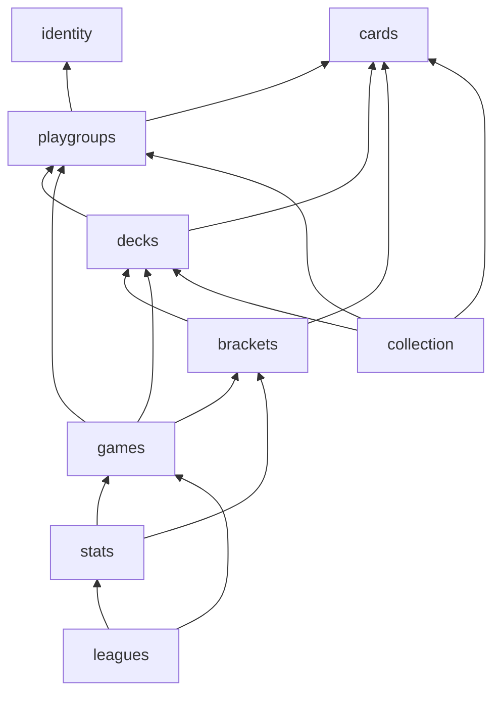
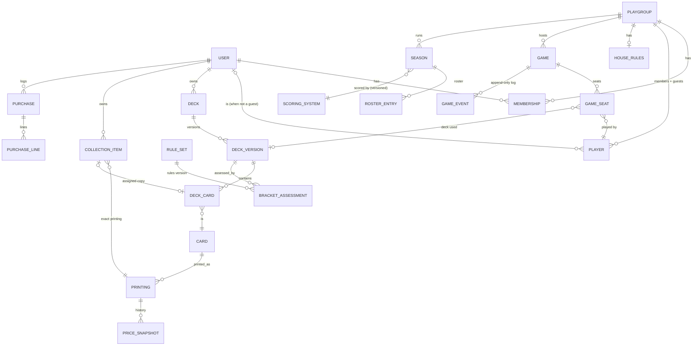

# MTG Stats — Architecture

Status: accepted (2026-11-07). Owner: orchestrator. Changes go through an ADR in [`docs/adr/`](adr/).
Related documents: [plan](plans/mtg-stats-plan.md) · [decisions log](backlog/OPEN-QUESTIONS.md) · [CLAUDE.md](../CLAUDE.md)

## 1. System overview

MTG Stats is a companion app for a private Commander playgroup. One **FastAPI** service is the single authority for data and live game state. Two clients use it: a **React web app** and an **Expo mobile app**, both written in TypeScript and sharing packages. An **arq worker** runs background jobs. **Postgres** stores everything, and **Redis** carries job queues and fans live-game events out to every connected client.



iPhone users use the web app, which can be added to the home screen. Native builds are Android only for now (decision I7).

## 2. Repository map

```
apps/
  api/                 FastAPI service + arq worker (one Python project, managed with uv)
    app/
      core/            config, db session, ids (UUID v7), auth dependencies, errors (problem+json),
                       paging, jobs (enqueue by name), websocket hub, logging
      <domain>/        identity, playgroups, cards, decks, brackets, games, stats, collection, leagues
      workflows/       orchestration that spans several domains (see §4.3)
      workers/         arq WorkerSettings, cron schedule, job registry
      main.py          app factory: routers, middleware, static web build
    migrations/        Alembic
    tests/             pytest (unit, service, API, WebSocket)
  web/                 React + Vite + React Router + TanStack Query + Zustand
  mobile/              Expo + Expo Router + TanStack Query + Zustand
packages/
  api-client/          types generated by openapi-typescript + an openapi-fetch client
  game-core/           TypeScript game reducer + vectors/ (JSON test vectors shared with Python)
  card-utils/          mana-cost parser, color identity, card formatting, legal/disclaimer text
infra/                 docker-compose.yml, Caddy/cloudflared config, deploy and backup scripts
docs/                  plan, backlog snapshot, architecture, ADRs, operations
```

Tooling: **uv** for Python, **pnpm workspaces** for TypeScript, and root `package.json` scripts that run both (`pnpm verify` runs the whole gate).

## 3. Backend layering


- **Routers** do no business logic. They validate input with schemas, resolve the current user, call one service function and return a schema.
- **Services** own transactions (`async with session.begin()`), permission checks beyond "logged in", and calls to other domains through their public interfaces.
- **Repositories** hold the queries that are reused. Every list query eager-loads what it serializes.
- **Models** may carry behavior about their own fields (a fat model is fine). Workflows that touch several models belong in services.
- **No ORM event listeners** for business logic, and no implicit side effects. Follow-ups are explicit calls or enqueued jobs.

## 4. Domains

### 4.1 Domain catalogue

| Domain | Owns (main models) | Epics |
|---|---|---|
| `identity` | User, credentials (argon2id), refresh tokens and sessions, site admin role, user preferences (currency, time-zone override) | E-2 (F-2.1, F-2.6 data rights entry points) |
| `playgroups` | Playgroup, Membership (roles: owner/admin/member), Invite and invite suggestion, Player (member or guest), guest tokens, HouseRules (bans and allowances, game defaults), PlaygroupSettings (`time_zone`, `low_sample_games`, staples threshold), profile and financial **privacy settings** | E-2 |
| `cards` | Card (`oracle_id`), Printing (Scryfall `id`, latest prices), Legality, PriceSnapshot, Scryfall sync state | E-3 |
| `decks` | Deck, DeckVersion, DeckCard, import sources and cache, validation results, sorting-board drafts | E-4 |
| `brackets` | RuleSet (versioned), rule categories and card lists, BracketAssessment, Spellbook combo cache, bracket-change notices | E-5 |
| `games` | Game, GameSeat, GameEvent (append-only), results, result amendments (audit), spectators, QR/join codes | E-6 |
| `stats` | per-seat fact table, daily card aggregates, activity and meta queries, dashboard layouts and widget catalog | E-7, E-8 |
| `collection` | CollectionItem (exact printing), deck-copy assignments, Purchase and PurchaseLine, sealed openings, valuation | E-9 |
| `leagues` | Season, roster entries (join/leave times), scoring systems (versioned), standings, achievements, matchmaking | E-10 |

`core/` isn't a domain. It holds shared plumbing only and never imports a domain.

### 4.2 Allowed dependencies (cycles forbidden)

A domain may import only the public `services` interface of the domains below it in this list:



Arrows mean "may call". The graph is transitive: anything reachable may be called. For example, `games` may call `identity`. Some examples:
- `games` → `decks.services` gets a deck version for a seat.
- `games` → `brackets.services` freezes a seat's bracket at `game_started` (S-6.2.10).
- `decks` → `playgroups.services` reads house bans and allowances for validation.
- `playgroups` → `cards.services` resolves the card names on house-ban lists.
- `leagues` → `stats.services` reads recent win rates for matchmaking.

**Forbidden directions** are any upward call, for example `decks` → `collection` or `games` → `stats`. CI enforces the rule with an import-graph test: `tests/architecture/test_domain_imports.py` parses the imports of each domain and fails on any edge that isn't in this graph.

### 4.3 Breaking would-be cycles

| Need | Mechanism |
|---|---|
| A saved or amended game result must refresh stats and league standings | `games` commits, then **enqueues arq jobs by name**: `stats.refresh_game` and `leagues.recompute_for_game`. These go through `core.jobs.enqueue`, so `games` never imports them. |
| Merging a guest into an account moves seats, roster entries and stats | `app/workflows/guest_merge.py` calls `playgroups`, `games`, `leagues` and `stats` in order |
| Data export and account deletion touch every domain | `app/workflows/data_rights.py` calls each domain's `export_user_data` / `anonymize_user` |
| A deck card's printing depends on the copy assigned to it in the collection (G4) | `collection` owns the assignments and exposes `effective_printings(deck_version)`. Deck screens that show owned or priced printings are composed by `collection` endpoints or on the client. `decks` never imports `collection`. |
| The profile spend widget (E-8) shows collection figures | The client calls `collection` endpoints directly. `collection` checks the sharing setting stored in `playgroups`. |

## 5. API conventions

- **Base path** `/api/v1`. The OpenAPI schema is generated by FastAPI, and `packages/api-client` is regenerated from it (openapi-typescript + openapi-fetch). Clients write their TanStack Query hooks by hand.
- **Auth**:
  - Login is by username and password.
  - The **access token** is a 15-minute JWT (PyJWT), sent as `Authorization: Bearer`.
  - The **refresh token** lasts 30 days and rotates on every use. On web it lives in an HttpOnly, Secure, SameSite=Lax cookie scoped to `/api/v1/auth`; on mobile it lives in expo-secure-store.
  - Guests get **game-scoped tokens**, valid until 24 h after the game ends, with a 7-day hard cap.
  - The site admin role is checked against the database on every request.
- **Errors** follow RFC 9457 `application/problem+json`: `{type, title, status, detail, code, errors?}`. `code` is stable and snake_case (`forbidden`, `section_hidden`, `game_closed` …). FastAPI's 422 responses are mapped to `code: "validation_error"` with `errors[]`.
- **Paging** uses a cursor: `?cursor=<opaque>&limit=50` (max 200) and returns `{items, next_cursor}`. Keyset order is `(created_at, id)` unless an endpoint documents another order.
- **Time**: every timestamp is UTC (ISO 8601 with `Z`). Day and week boundaries use the effective time zone: the user's override, else the playgroup's. Weeks start on ISO Monday.
- **Money**: `{amount: "12.34", currency: "USD"}` as a decimal string. Each user picks one currency, USD or EUR, and nothing is ever converted.
- **Links**: shareable links are `https://<PUBLIC_WEB_URL>/…`. The page offers "Open in app" via `mtgstats://…`, and `mtgstats://` is also used for in-app navigation. Android App Links arrive in Phase 5.

## 6. Real-time game flow

### 6.1 Contract

- **Event envelope**: `event_id` (a UUID v4 generated by the client, which makes events idempotent), `game_id`, `seq` (assigned by the server), `type`, `payload`, `actor`, `on_behalf_of_seat`, `ts` (server UTC) and `v` (schema version).
- **Reducers**: `reduce(state, event) → state | error` is implemented twice, in `packages/game-core` (TypeScript) and `app/games/core/` (Python). Both are pure: no clock, no randomness and no I/O. Both must pass every file in `packages/game-core/vectors/` and produce **byte-identical canonical JSON**.
- **Storage**: `game_events` is append-only, with unique `(game_id, seq)` and `(game_id, event_id)`. The event row, `games.state` and `games.last_seq` are written in **one transaction**.
- **Undo** appends a compensating `event_reverted`. Corrections, such as fixing seats mid-game or amending results, are new events or audit rows. Existing rows are never edited.

### 6.2 Flow

```mermaid
sequenceDiagram
  participant C as Client (web/mobile)
  participant A as API process (WS room)
  participant DB as Postgres
  participant R as Redis pub/sub
  participant O as Other clients / processes
  C->>A: connect /ws/games/{id}
  C->>A: {type:"auth", token}  (within 5 s)
  A-->>C: welcome {role, seat, state, last_seq}
  C->>C: apply event optimistically (game-core)
  C->>A: event {event_id, type, payload}
  A->>A: authorize (trust mode, role) + reduce (Python core)
  A->>DB: BEGIN; append event (seq = last_seq+1); update state; COMMIT
  A-->>C: ack {event_id, seq}
  A->>R: publish game:{id} (after commit only)
  R-->>O: event {seq, …}
  O->>O: apply in seq order; on gap → sync {since}
```

- **Rejections** reply `reject {event_id, code}`; nothing is stored or broadcast. A duplicate `event_id` returns the original `ack`.
- **Ordering**: clients apply events in strictly increasing `seq`. A gap triggers `sync {since}`. A client more than 500 events behind gets a snapshot instead.
- **Reconnect**: back off at 0.5, 1, 2 and 4 s, capped at 10 s, with jitter. After reconnecting, the client sends `sync`, then resends its pending local events with their original `event_id`s.
- **Heartbeat**: a ping every 15 s; a socket that misses replies for 30 s is closed. **Close codes**: 4401 means unauthenticated or auth expired, 4403 means not allowed in this game, 4404 means unknown game.
- **Trust modes** (D1): in `casual`, any seated player may change any seat. In `strict`, a player changes only their own seat and events they are the source of, and the host may change anything. Only the host can change settings, start, end, abandon or resume, correct seats or switch the control mode.
- **Fan-out** goes through Redis even with a single production instance. This keeps several uvicorn workers safe and is covered by the multi-process soak test.

### 6.3 After the game

Ending a game runs `game_ended`, then the host confirms the summary (which is auto-filled from the log), then results are saved in `games`. Saving enqueues `stats.refresh_game` and `leagues.recompute_for_game`. When an admin amends a result, an audit row is written and the same jobs are enqueued again.

**Placements** use competition ranking (1, 2, 3, 3). In a full draw, `no_winner` is true and the survivors share placement 1 with outcome `draw`. Abandoned games never count in stats or leagues.

## 7. Background jobs (arq)

| Job | Trigger | Domain |
|---|---|---|
| `cards.scryfall_sync` | daily, 09:00 UTC | cards. Streams the bulk files with ijson, upserts cards and printings, and updates the latest prices on every printing. |
| `cards.price_snapshots` | after the sync | cards. Daily history for owned or in-deck printings only. |
| `cards.thin_snapshots` | weekly | cards. Thins history older than 2 years to weekly. |
| `cards.lookup_foreign_printing` | on demand | cards. Cached Scryfall API lookup (G9). |
| `decks.fetch_import` | on demand | decks. Moxfield/Archidekt fetch with cache. |
| `brackets.spellbook_check` | when a deck version is assessed | brackets. Commander Spellbook query with a 7-day cache. |
| `brackets.reassess_on_ruleset` | when a rule set is published | brackets. Reassesses decks and creates notices. |
| `stats.refresh_game` | after results are saved or amended | stats. Idempotent rebuild of one game's fact rows. |
| `stats.rebuild_all` | weekly + CLI | stats. Full rebuild. |
| `leagues.recompute_for_game` | after results are saved or amended | leagues. Season standings. |
| `games.auto_abandon` | every 10 min | games. Lobbies idle for 2 h and games idle for 24 h are abandoned. |
| `ops.backup` | daily | infra. pg_dump with GnuPG encryption, copied to the second disk or NAS. Recorded in `job_runs`. |

Jobs are enqueued **by name** through `core.jobs.enqueue(name, **kwargs)` and must be idempotent. Every run is recorded in `job_runs`, and `/api/v1/health/ops` reports stale or failed jobs to the uptime monitor.

## 8. Domain model (overview)



## 9. Clients

- **Shared packages**:
  - `api-client`: generated types plus a configured openapi-fetch instance.
  - `game-core`: the reducer, the event types and a sync engine that handles optimistic apply, reconcile by `seq`, pending-event resend and backoff.
  - `card-utils`: helpers and the Fan Content Policy disclaimer text.
- **Server state** lives in TanStack Query hooks per domain (`useDeck`, `useGameResults` …). **Client state** (table UI, drafts, the dashboard layout before it is saved) lives in Zustand. **Live game state** comes from the game-core sync engine over the WebSocket, not from TanStack Query.
- **Web** uses React Router; dnd-kit for seats, damage and the sorting board; react-grid-layout for the dashboard; and Recharts for charts.
- **Mobile** uses Expo Router; Gesture Handler and Reanimated for drag; victory-native for charts; expo-secure-store, expo-keep-awake and expo-haptics; and react-native-svg for mana symbols.
- **Accessibility**: every drag has a tap or keyboard alternative. These are listed in each story's acceptance criteria.

## 10. Deployment and operations (Phase 5)

- **Hosting** is one home server or VPS running Docker Compose (`api`, `worker`, `postgres`, `redis`, `cloudflared`). There are **no open ports**: traffic arrives through a Cloudflare Tunnel on the owner's domain. There is one API container, which also serves the web build as static files. Images are stored in GitHub Container Registry.
- **Deploy**: the owner runs a deploy script over SSH, so GitHub holds no production credentials. There is production only, with no staging.
- **Backups**: daily, encrypted to the owner's GnuPG key, kept 14 days, copied to a second disk or NAS, with a restore drill every quarter. The recovery point is within 24 h and the restore target is 4 h.
- **Observability**: structured JSON logs carrying request and game IDs, kept 30 days; an admin page listing recent 5xx errors; an external uptime monitor checking `/health` and `/api/v1/health/ops`; and pip-audit and Dependabot in CI. There is no Sentry and no EAS Update.

## 11. Cross-cutting rules

- **IDs**: UUID v7 from `app/core/ids.py`, a standard-library implementation because Python 3.12 has no `uuid7`.
- **Security**: argon2id password hashing; sign-in rate limiting (S-2.1.10, reused by S-11.6.2); CORS limited to `PUBLIC_WEB_URL`; secrets only in env and never in the repo; pre-commit secret checks.
- **Privacy**: spend and collection value are private by default. Profile sections can be hidden. A deleted user's seats become "Deleted player".
- **External services** (Scryfall, Commander Spellbook, Moxfield, Archidekt) always get an honest User-Agent, caching and backoff. The app checks each site's terms before building against it.
