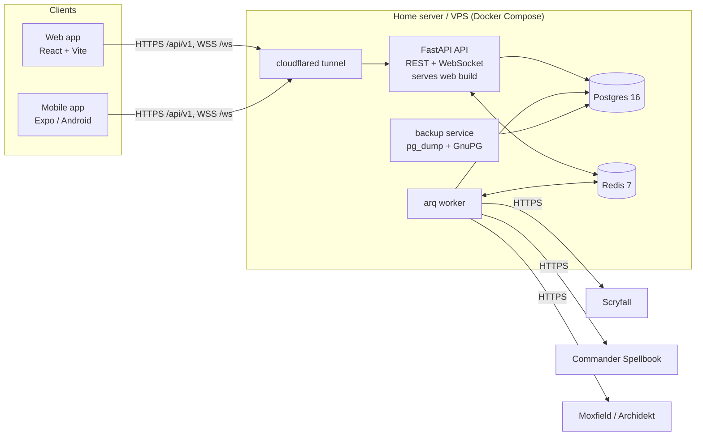
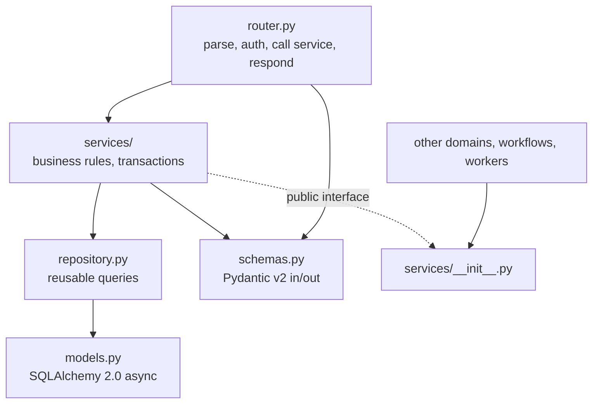
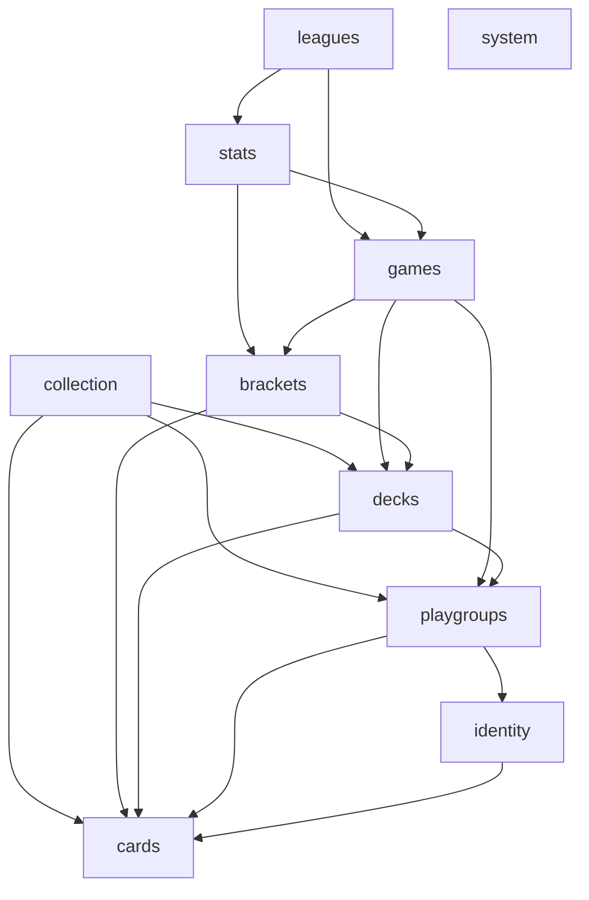
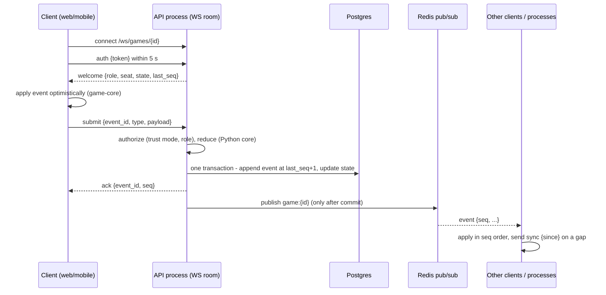
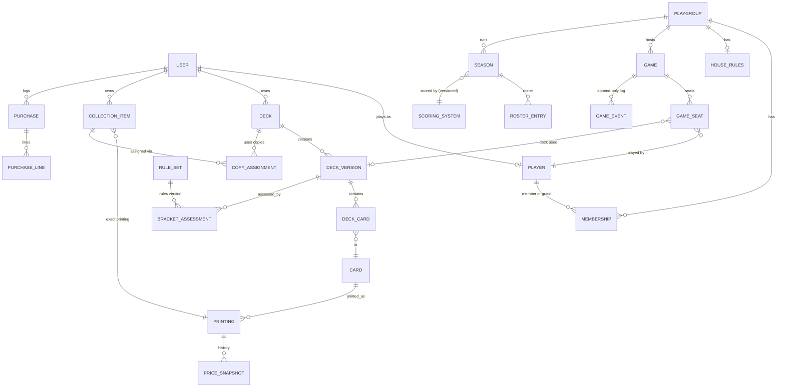

# MTG Stats — Architecture

Status: accepted (2026-11-07, revised after two PR #448 review rounds). Owner: orchestrator. Changes go through an ADR in [`docs/adr/`](adr/).
Related documents: [plan](plans/mtg-stats-plan.md) · [decisions log](backlog/OPEN-QUESTIONS.md) · [CLAUDE.md](../CLAUDE.md)

## 1. System overview

MTG Stats is a companion app for a private Commander playgroup. One **FastAPI** service is the single authority for data and live game state. Two clients use it: a **React web app** and an **Expo mobile app**, both written in TypeScript and sharing packages. An **arq worker** runs background jobs. **Postgres** stores everything, and **Redis** carries job queues and fans live-game events out to every connected client.



iPhone users use the web app, which can be added to the home screen. Native builds are Android only for now; Apple will be revisited later (the "iPhone" decision, rounds 18–20).

## 2. Repository map

```
apps/
  api/                 FastAPI service + arq worker (one Python project, managed with uv; run uv commands here)
    app/
      core/            config, db session, ids (UUID v7), auth (JWT + current_user + pluggable
                       require_site_admin), errors, paging, links (public_link), jobs (enqueue by
                       name, after commit), websocket hub, logging
      <domain>/        system, identity, playgroups, cards, decks, brackets, games, stats,
                       collection, leagues
                       each: models.py, schemas.py, router.py, services/, repository.py, tests/
      workflows/       orchestration that spans several domains, with its own routers and jobs (§4.3)
      workers/         arq WorkerSettings, cron schedule, job registry
      cli/             operator command line (`python -m app.cli`), an entry point like workers/
      main.py          app factory: routers, middleware, static web build
      model_registry.py  imports every domain's models for Alembic (S-1.4.3); only migrations/env.py
                       and tests import it
    migrations/        Alembic
    tests/             cross-cutting tests (architecture, API smoke, WebSocket soak)
  web/                 React + Vite + React Router + TanStack Query + Zustand; e2e/ (Playwright)
  mobile/              Expo + Expo Router + TanStack Query + Zustand; e2e/ (Maestro)
packages/
  api-client/          @mtg-stats/api-client: openapi-typescript types + an openapi-fetch client
  game-core/           TypeScript game reducer + vectors/ (JSON test vectors shared with Python)
  card-utils/          mana-cost parser, color identity, card formatting, legal/disclaimer text
infra/                 docker-compose.yml (api, worker, postgres, redis, cloudflared, backup, migrate),
                       deploy and backup scripts
docs/                  plan, backlog snapshot, architecture, ADRs, design notes, operations
```

Tooling: **uv** for Python, **pnpm workspaces** for TypeScript, and root `package.json` scripts that run both. `pnpm verify` runs the whole gate; `verify:api` and `verify:ts` run one half (S-1.8.1).

## 3. Backend layering



- **Routers** do no business logic. They validate input with schemas, resolve the current user, call one service function and return a schema.
- **Services** own transactions and permission checks beyond "logged in". They reach other domains only through those domains' public interfaces.
- **Unit of work**: a public service function accepts an optional caller `AsyncSession`. When it's given, the function joins the caller's transaction instead of opening its own. Workflows use this to span several domains in **one transaction**.
  - A service running in a caller's session **never commits and never enqueues directly**.
  - Every follow-up runs after the outermost transaction commits, through `core.db.after_commit(session, callback)`, and is dropped on rollback.
  - `core.jobs.enqueue_after_commit(session, name, **kwargs)` is built on that hook, and so is WebSocket pub/sub publishing (game events, `draft_changed`).
- **Repositories** query only their own domain's tables. A read that needs another domain's data goes through that domain's `services`.
- Repositories hold the queries that are reused. Every list query eager-loads what it serializes.
- **Models** may carry behavior about their own fields (a fat model is fine). Workflows that touch several models belong in services.
- **No ORM event listeners** for business logic, and no implicit side effects. Follow-ups are explicit calls or enqueued jobs.

## 4. Domains

### 4.1 Domain catalogue

| Domain | Owns (main models) | Epics |
|---|---|---|
| `system` | health endpoints (`live`, `ready`, `jobs`, `ops`), `job_runs`, the admin 5xx error list. It is the reference example of the domain layout (S-1.4.4). | E-1, E-11 |
| `identity` | User, **Player** (one per user; guest players have no user), player profile fields (display name, avatar, validated through `cards`), credentials (argon2id), refresh tokens and sessions, password-reset tokens and their audit, site admin role (it registers the site-admin check with `core.auth`), user preferences (time-zone override) | E-2 (F-2.1, F-2.2, F-2.3 player records) |
| `playgroups` | Playgroup, Membership (player, role: owner/admin/member/guest), former memberships, Invite and invite suggestion, HouseRules (bans, allowances, game defaults), PlaygroupSettings (`time_zone`, `low_sample_games`, staples threshold), **profile privacy and `profile_visibility()`** (S-2.2.5), the **player profile view** `GET /players/{id}` (S-2.2.3), **per-playgroup spend and collection-value sharing** `financials_visible_to()` (S-8.3.6), and the admin password-reset routes (S-2.1.9) | E-2 (F-2.2 views, F-2.4, F-2.5), E-8 (sharing) |
| `cards` | Card (`oracle_id`), Printing (Scryfall `id`, latest prices on every printing), Legality, PriceSnapshot, sync state | E-3 |
| `decks` | Deck, DeckVersion (with a `used_in_game` flag that `games` sets), DeckCard, import sources and cache, validation results, sorting-board drafts | E-4 |
| `brackets` | RuleSet (versioned), rule categories and card lists, BracketAssessment, Spellbook combo cache, bracket-change notices; also serves the **draft bracket preview** endpoint (S-4.7.5), `GET /decks/{id}/versions/{n}/bracket` (T-5.3.4.3) and the batch read `latest_assessments(deck_ids)` for deck lists (S-5.3.4) | E-5 |
| `games` | Game, GameSeat, GameEvent (append-only, with two audited exceptions, §6.1), **guest game tokens** (S-2.3.2), results, result amendments (audit), spectators, join codes and QR, **`can_view_game()`** for former members (S-2.4.4), `invite_from_game` (S-6.7.7) | E-6 |
| `stats` | per-seat fact table, daily card aggregates, activity and meta queries, dashboard layouts and widget catalog | E-7, E-8 |
| `collection` | CollectionItem (exact printing), CopyAssignment (collection item ↔ **deck**, per printing and quantity; keyed by deck, because deck versions are immutable), Purchase and PurchaseLine, sealed openings, valuation and the **valuation currency** setting (S-9.5.6) | E-9 |
| `leagues` | Season, roster entries (join/leave times), scoring systems (versioned), standings, achievements, matchmaking; also serves the **season-filtered stats** endpoints (S-10.3.8) | E-10 |

`core/` isn't a domain. It holds shared plumbing only and **never imports a domain**.
- `core.auth` provides `current_user`, which decodes the JWT; access tokens are accepted until they expire (S-2.1.4).
- It also provides `require_site_admin`. That calls a site-admin checker protocol, which `identity` registers in `main.py`, so the role is still read from the database on every request (S-2.1.11).
- So **every domain can use the auth dependencies without importing `identity`**.

**How backlog names map to domains.** Some stories use other names:

| Name in stories | Domain |
|---|---|
| "players" domain, `players/services` | `identity` for Player records and profile fields. `playgroups` for anything that needs membership: `profile_visibility`, the profile view, `financials_visible_to`, guest membership |
| "prices" domain | `cards` |
| "auth", "accounts" | `identity`; the request dependencies are in `core.auth` |
| "purchases" | `collection` |
| "dashboard", "activity", "meta" | `stats` |
| "system" | `system` |

### 4.2 Allowed dependencies (cycles forbidden)

A domain may import the public `services` interface of any domain it can reach by **following the arrows**. The graph is transitive, so `games` may call `identity` through `playgroups`. Nothing else is allowed.



Arrows mean "may call", and they point **down** to lower layers. Some examples:
- `games` → `decks.services` gets a deck version for a seat.
- `games` → `brackets.services` freezes a seat's bracket at `game_started` (S-6.2.10).
- `decks` → `playgroups.services` reads house bans and allowances for validation.
- `playgroups` → `cards.services` resolves the card names on house-ban lists.
- `identity` → `cards.services` validates the printing chosen for an avatar (S-2.2.2).
- `games` → `decks.services` marks a deck version as used when a game starts (S-4.4.2).
- `system` is a leaf. It uses only `core`.
- `leagues` → `stats.services` reads recent win rates for matchmaking.
- `collection` → `playgroups.services` checks `financials_visible_to` before showing figures to someone else.

**Enforcement**: `apps/api/tests/architecture/test_domain_imports.py` computes the transitive closure of this graph. It fails when:
- an import between domains isn't in the closure;
- a domain imports `workflows/`, `workers/` or `cli/` (jobs are enqueued by name, never imported, and `cli/` is an entry point);
- `core/` imports any domain, `workflows/`, `workers/` or `cli/`;
- `workflows/` imports `workers/` or `cli/`, or `workers/` imports `cli/`;
- a domain imports another domain, or `workflows/`, `workers/` or `cli/` import a domain, through anything other than exactly `app.<domain>.services`;
- a domain, `core/`, `workflows/`, `workers/` or `cli/` imports anything under `app` outside its allowlist. The allowlist is its own package, `app.core`, the `services` of the domains it may use, and for `workers/` and `cli/` also `workflows/`. So `app.main`, `app.scripts` and any other `app.x` are out;
- a **router module** in a domain imports its own `repository`, or a router module in a domain or in `workflows/` imports anything from `sqlalchemy` (S-1.4.6). A router module is a module that imports `fastapi.APIRouter`, or one that imports a router module of its own package (a split file that adds routes to `router.py`'s router). This covers `router.py`, split router files and the per-workflow routers of §4.3;
- anything under `app/` other than the registry itself, including `app/main.py`, imports `app/model_registry.py`. Only `migrations/env.py` and the tests under `apps/api/tests/` may import it;
- a package or module directly under `app/` is not one of: the ten domains, `core`, `workflows`, `workers`, `cli`, `scripts`, `main.py`, `model_registry.py` or `__init__.py`.

Literal-string dynamic imports (`importlib.import_module("…")`, including its keyword and literal-relative forms, and `__import__("…")` with a single name argument) count as imports. The following are left to review:
- attribute access through an allowed import (for example `app.decks.services.helpers` after `import app.decks.services`);
- non-literal dynamic imports, and `__import__` with `fromlist` or `level`;
- `APIRouter` reached through a re-export or `getattr`, and routes added with `add_api_route` from a module that imports no router;
- a router using `SessionDep` with its own `models`.

Domain tests (`app/<domain>/tests/`) obey their domain's rules. They test the domain's own code; tests that need the whole app (`app.main`: middleware, lifespan, OpenAPI) are acceptance tests in `apps/api/tests/`. Cross-domain factories live in `apps/api/tests/factories.py`. `app/main.py` (the app factory, which mounts every router) and `app/scripts/` are outside these rules, except the registry rule and the rule that only `cli/` imports `cli/`. `cli/` follows `workers/`'s rule (domain `services` only, `app.core`, `app.workflows`) and nothing imports it. `workers/` may import `workflows/`, because the job registry registers workflow jobs. It extends S-1.4.6's boundary test; `docs/domain-template.md` describes the layout of one domain.

### 4.3 Breaking would-be cycles

Each row is a need from the backlog that would otherwise require an upward call.

| Need | Story | Mechanism |
|---|---|---|
| Registration locks the invite, then creates the User and Player and consumes the invite, in one transaction | S-2.1.3, S-2.3.3 | **Workflow** `workflows/registration.py`. In one session, in this order: `playgroups.lock_invite` (check it, `SELECT … FOR UPDATE`), `identity.create_user_with_player`, then `playgroups.consume_invite` (use count and membership). When the new account claims a guest, it keeps the guest's player id, so no merge runs. The workflow enqueues `stats.rebuild_games_for_players` after commit (S-2.3.3, S-7.1.7). Claiming into an *existing* account goes through `workflows/guest_merge.py`. |
| Auth dependencies need the database | S-2.1.4, S-2.1.11 | **Ownership**: the dependencies live in `core.auth`, with a site-admin checker that `identity` registers (see §4.1). `cards` and `system` use them without importing `identity`. |
| Admin password reset combines membership rules with the reset token | S-2.1.9 | **Ownership**: the routes are in `playgroups`, which checks the rules and then calls `identity.issue_reset_token` (a downward call). |
| Profile visibility and the profile view need "shares a playgroup" | S-2.2.3, S-2.2.5 | **Ownership**: `profile_visibility()` and `GET /players/{id}` are in `playgroups`. They read the profile from `identity`. |
| A guest token must stop working after its game ends or is abandoned | S-2.3.2 | **Ownership**: guest game tokens and the `get_game_actor` dependency live in `games`. |
| Former members can view games they played | S-2.4.4 | **Ownership**: `games.can_view_game(player_id, game_id)` is built on `playgroups.former_playgroups`. |
| Invite non-members after a game | S-2.4.6, S-6.7.7 | **Inverted call**: the `games` service `invite_from_game` works out which seats are non-members and passes `(playgroup_id, player_ids, played_on)` to `playgroups.invite_status_for_seats` / `invite_after_game`. |
| Per-playgroup sharing of spend and collection value | S-8.3.6, S-9.4.1, S-9.5.x, S-9.6.1 | **Ownership**: `financials_visible_to()` is in `playgroups` (per membership). `collection` and `stats` call it. S-2.2.5's global flags are dropped (product-owner decision). |
| Price history only for printings that are owned or in a deck, plus the follow-ups after the sync | S-3.4.2, S-3.4.3, S-3.1.5, S-4.5.1, S-5.1.8, S-9.5.3 | **Workflow job** `workflows.scryfall_daily_sync`:<br>1. Gets the tracked printing IDs from `decks` and `collection`.<br>2. Calls `cards.run_bulk_sync(tracked_printing_ids=…)`, which writes the snapshots in the same pass.<br>3. After commit, enqueues by name `decks.revalidate_all`, `brackets.check_game_changers` and `collection.refresh_valuations`. |
| Saving a deck version records the assigned copy's printing and reports the copies released; archiving or deleting releases them all | S-4.1.6, S-9.6.6, S-9.6.7 | **Workflow** `workflows/deck_save.py` serves every save, archive and delete endpoint (import, editing, sorting-board commit). In one session:<br>0. Create the Deck, or lock it if it exists, so a new deck has an id before claiming.<br>1. `collection.claim_copies_for_deck` returns the printing for each deck card.<br>2. `decks.save_version(printings=…)` splits lines by printing.<br>3. `collection.release_surplus` returns the copies released, which go in the save response.<br><br>Archiving or deleting calls `collection.release_for_deck`. Before Phase 3 the collection calls return nothing. `decks` never imports `collection`. |
| A deck used in a recorded game is archived, not deleted | S-4.4.2, S-2.6.2 | **Plain downward call** (listed because the story wording implied an upward one): at `game_started`, `games` calls `decks.mark_version_used`. `decks` archives instead of deleting when the flag is set. |
| Draft bracket preview on the sorting board | S-4.7.5 | **Ownership**: the endpoint is implemented by the `brackets` router (same URL) and calls `decks` for the draft and validation. |
| Bracket assessment when a deck version is saved | S-5.3.x | **Job by name**: `brackets.assess_deck_version`, enqueued after commit by `workflows/deck_save.py`. |
| Results saved or amended must refresh stats and standings | S-6.7.4, S-6.7.6 | **Jobs by name**, after commit: `stats.refresh_game_stats` and `leagues.recompute_for_game`. |
| A playgroup time-zone change must rebuild the card aggregates | S-2.4.7, T-7.5.1.4 | **Job by name**: `stats.rebuild_card_aggregates`, enqueued after commit by `playgroups`. |
| Season filter on stats | S-10.3.8 | **Inverted call**: `stats` queries accept an optional `game_ids` filter. The season-filtered endpoints are in the `leagues` router, which passes `leagues.counted_game_ids(season)`. |
| The profile spend widget shows collection figures | S-8.3.4 | **Client composition**: the widget calls `collection` endpoints. The stats widget catalog only declares the widget. |
| Merging a guest into an account | S-2.3.4, S-2.3.5, S-7.1.7, S-10.3.7 | **Workflow** `workflows/guest_merge.py`, in one session: `identity`, `playgroups`, `games.reassign_player` (an audited event-log exception), `leagues`. After commit it enqueues `stats.rebuild_games_for_players` and `leagues.recompute_for_players`. Its router also serves the merge preview, built on `games.find_shared_games`. |
| Deck lists show each deck's bracket badge | S-5.3.4, S-5.4.1 | **Client composition**: clients fetch `GET /decks`, then one batch call to a `brackets` endpoint backed by `brackets.latest_assessments(deck_ids)` (one query per page). `decks` never imports `brackets`. |
| Profile shows games played and win rate; "Former playgroups" lists the games played there | S-2.2.3, S-2.4.4 | **Client composition**: the profile view (`playgroups`) returns profile data only. The client adds the stats player summary (S-8.3.1) and `GET /players/me/games` (S-7.3.6). |
| Playgroup delete confirmation shows how many games will be deleted | S-2.6.3 | **Ownership**: the delete preview is served by the `workflows/data_rights.py` router, which asks `games` for the count. |
| Data export, account deletion, playgroup deletion | S-2.6.1–S-2.6.3 | **Workflow** `workflows/data_rights.py`. It calls each domain's `export_user_data` / `delete_user_data`. Playgroup deletion runs as the job `workflows.delete_playgroup`, which uses `games.delete_playgroup_data` (an audited event-log exception). |
| Jobs health lists each scheduled job with its interval | S-1.9.4 | **Inverted call**: `main.py` puts `workers.schedule.scheduled_intervals` on `app.state.job_intervals_provider` (called on the first request, not at startup), and the router passes it to `system.jobs_health(session, intervals)`. `system` never imports `workers`. |

**The five mechanisms** are a workflow, a job enqueued by name, an inverted call, a change of ownership and client composition. A new case needs a row here before any code is written. A plain downward call needs no mechanism; it gets a row only where a story's wording suggested an upward call.

**Jobs by name**: any domain may enqueue a job of any domain or of `workflows` by name (for example `playgroups` enqueues `workflows.delete_playgroup`), because enqueueing imports nothing.

**Workflows**:
- Each workflow module may define its own FastAPI router, registered in `main.py`, and its own arq jobs. It may import any domain's `services`.
- No domain imports `workflows`.
- Jobs are named `<domain>.<job>` or `workflows.<job>`.

## 5. API conventions

- **Base path** `/api/v1`. The OpenAPI schema is generated by FastAPI, and `@mtg-stats/api-client` is regenerated from it (openapi-typescript + openapi-fetch). CI fails when the generated client drifts. Clients write their TanStack Query hooks by hand.
- **Auth** (S-2.1.x):
  - Login is by username and password.
  - The **access token** is a 15-minute JWT (PyJWT), sent as `Authorization: Bearer`.
  - The **refresh token** lasts 30 days and rotates on every use. On web it lives in an `HttpOnly`, `Secure`, **`SameSite=Strict`** cookie scoped to the auth routes, and never appears in a response body (S-2.1.5). On mobile it comes in the body and is stored in expo-secure-store.
  - **Client mode**: a request is mobile only when it has `X-Client: mobile` and no `Origin` header; every other request is web. Web gets the refresh token only as the `mtgstats_refresh` cookie (`HttpOnly`, `Secure`, `SameSite=Strict`, `Path=/api/v1/auth`), and mobile gets it only in the body.
  - **Single-flight refresh**: refresh tokens rotate per use, and reuse of any revoked token revokes its whole family. Clients must therefore refresh one at a time: one refresh across all tabs on web, and one in-flight promise on mobile.
  - Guests get **game-scoped tokens**, issued by `games`, valid until 24 h after the game ends or is abandoned, with a 7-day hard cap.
  - The site admin role is checked against the database on every request (`core.auth.require_site_admin`, through a checker that `create_app` registers from `identity`).
  - **Throttling** (S-2.1.10, `core/rate_limit.py`): Redis fixed-window counters, updated by one atomic Lua script that checks every limit and then increments, so concurrent attempts cannot slip past a limit. Each counter gets its TTL when first created. `POST /auth/login` counts the attempt first (per username: 5, per IP: 20, in 15 minutes by default) and returns 429 `rate_limited` with `Retry-After` when either is reached, before any password check. A wrong password keeps its count; a success deletes the username counter and gives back the IP count. `POST /auth/register` and `POST /invites/preview` share one per-IP bucket (30 per 15 minutes; reset completion joins it in S-2.1.9) through `PublicRateLimitDep`. All limits are settings (and `REDIS_CALL_TIMEOUT_SECONDS`). The limiter **fails open**: a Redis error or timeout lets the request through and logs a warning. It needs Lua scripting only, no particular Redis version.
  - **Change password** (S-2.1.8): `POST /auth/change-password` (bearer) verifies the current password (400 `invalid_current_password`, field error on `current_password`), validates the new one like registration (422), sets it, revokes all of the user's refresh tokens and returns new tokens like login. It shares the sign-in throttle keys and limits (429 `rate_limited`).
  - **Client IP**: `request.client.host`; the app never reads `X-Forwarded-For` itself. Uvicorn's `--proxy-headers` is on by default but trusts only 127.0.0.1, so behind a reverse proxy set `--forwarded-allow-ips=<proxy ip>` (or `FORWARDED_ALLOW_IPS`); otherwise every client shares the proxy's IP and its limits. When `request.client` is `None` (a Unix socket), all clients share the `"unknown"` bucket.
- **Errors** (S-1.4.5): every error (422, 401, 403, 404, 409, 429, 500) returns
  `{"error": {"code": "<snake_case>", "message": "<text>", "details": <object|null>, "request_id": "<id>"}}`.
  - `code` is stable (`forbidden`, `section_hidden`, `game_closed` …), and clients switch on it, never on `message`.
  - The house rules **note** (S-2.5.4) is free text on the playgroup: `GET /playgroups/{id}/house-rules` for any active member and `PUT /playgroups/{id}/house-rules` for the owner or an admin (`{text}` up to 5,000 characters; 422 above that or for control characters). It is stored and returned exactly as sent and never sanitised (the one exception: a whitespace-only text is stored as `""`, which clears the rules), control characters other than tab, newline and carriage return are rejected with 422, and clients render it as plain text. The response carries `edited_by` (`player_id`, current `display_name`) and `edited_at`, null until the first save. The structured bans, allowances and game defaults are separate (S-2.5.x).
  - `invite_no_longer_valid` (410) is returned for a revoked, expired, used-up or unknown invite (S-2.1.2). Invite routes are owned by `playgroups`. Site-level invites, which join no playgroup, use `POST /invites` (site admin only), `GET /invites` and `POST /invites/{id}/revoke`. Playgroup invites (S-2.4.2) use `POST /playgroups/{id}/invites`, `GET /playgroups/{id}/invites` and `POST /playgroups/{id}/invites/{invite_id}/revoke`, for the playgroup's owner or an admin. The public `POST /invites/preview` serves both kinds (the token is in the body, never in a URL) and shows the playgroup's name for a playgroup invite. A signed-in user joins with `POST /invites/join`: an active member of the playgroup gets `already_member: true` whatever the invite's state, and anyone else needs a valid invite. `POST /auth/register` is served by the registration workflow, which also creates the membership when the invite belongs to a playgroup. The player profile (S-2.2.3) is `GET /players/{id}` in `playgroups`: display name, avatar color, guest flag, `member_since` (the player record's `created_at`) and the playgroups in common, never stats. It is the viewer's own profile, or a player who shares an active membership with the viewer (a guest also counts through its `home_playgroup_id`); anything else, an unknown id included, is the same 404 `not_found`. A merged guest answers 308 with `Location` set to the survivor's profile and `Cache-Control: no-store`, only when the viewer could open both the old guest (by the same rule, or is the survivor) and the survivor (else the same 404).
  - Validation errors go in `details`.
  - Guest players (S-2.3.1) are added and renamed through `playgroups`: `POST /playgroups/{id}/guests` (any member, 201) and `PATCH /playgroups/{id}/guests/{player_id}` (the guest's creator, the owner or an admin; any other member gets 403 `forbidden`). A name that matches a member or guest of the playgroup, ignoring case and accents, is 409 `player_name_taken`. The playgroup row is locked `FOR UPDATE` for every guest write, so concurrent writes cannot both pass the check. `players.created_by_id` records who added the guest; a guest has `user_id` NULL, so it has no credentials.
  - **`DomainError.persist_changes`**: normally a raised error rolls the request's session back. A subclass that sets `persist_changes = True` makes `get_session` commit what was flushed, then re-raise, so a rejected request can keep its side effect (for example revoking a token family on reuse). Raise such an error only from a request whose only writes are that intended side effect, and never inside a composite workflow, because the commit would also persist the workflow's other writes.
  - `request_id` also appears in the logs and the response headers. An unknown `/api/...` path returns this JSON 404 rather than the web app.
  - Health probes (`/api/v1/health/*`, S-1.4.4) are the exception: they return their own body for every status, including the 503 from `ready`, which reports each dependency check. A probe result is not a request error.
- **Paging** uses a cursor: `?cursor=<opaque>&limit=50` (max 200) and returns `{items, next_cursor}`. Keyset order is `(created_at, id)` unless an endpoint documents another order. The helpers are in `app/core/paging.py` (S-1.4.7). Each list endpoint's response model is a named subclass, such as `class DeckPage(Page[DeckOut])`, so the OpenAPI component and the generated TypeScript type are called `DeckPage`. A malformed cursor, or one made for another sort, returns 422 `invalid_cursor`.
- **Time**: every timestamp is UTC (ISO 8601 with `Z`). Day and week boundaries use the effective time zone: the user's override, else the playgroup's. Weeks start on ISO Monday.
- **Money**: `{amount: "12.34", currency: "USD"}` as a decimal string. Each user picks one currency, USD or EUR, and nothing is ever converted.
- **Links** (S-1.6.7, which refines decision B6):
  - Shareable links are built on the server only, with `app/core/links.py` `public_link(kind, value)`, which returns `<PUBLIC_WEB_URL>/<kind>/<value>` for `invite`, `reset` and `join`.
  - The public pages show an `OpenInAppButton` that links to `mtgstats://<kind>/<value>` on Android browsers only, while the native app is Android-only (decision on #38).
  - The mobile app uses `mtgstats://` for in-app navigation.
  - Universal and App Links replace the button in Phase 5 (S-11.5.6). Native is Android only for now, so in practice that means Android App Links.
- **CORS**: only `CORS_ALLOWED_ORIGINS` (S-1.4.1). In `dev`, the web dev server origin is allowed.

## 6. Real-time game flow

### 6.1 Contract

- **Event envelope** (S-6.1.1): `event_id` (a UUID v4 generated by the client, which makes events idempotent), `game_id`, `seq` (assigned by the server), `type`, `payload`, `actor`, `on_behalf_of_seat`, `ts` (server UTC) and `v` (schema version).
- **Reducers**: `reduce(state, event) → state | error` is implemented twice, in `packages/game-core` (TypeScript) and `app/games/core/` (Python). Both are pure: no clock, no randomness and no I/O. Both must pass every file in `packages/game-core/vectors/` and produce **byte-identical canonical JSON**.
- **Storage** (S-6.3.1): `game_events` is append-only, with unique `(game_id, seq)` and `(game_id, event_id)`. The event row, `games.state` and `games.last_seq` are written in **one transaction**.
- **Undo** appends a compensating `event_reverted`. Corrections, such as fixing seats mid-game or amending results, are new events or audit rows.
- Existing rows are never edited, **with two audited exceptions** (product-owner decision):
  - `games.reassign_player`, during a guest merge (S-2.3.4).
  - `games.delete_playgroup_data`, during playgroup deletion (S-2.6.3).

  Each writes an audit row. No other code may update or delete `game_events`.
- **How the append works** (S-6.3.1): `games.append_event` locks the game row with `SELECT … FOR NO KEY UPDATE`, assigns `last_seq + 1`, runs the Python reducer, and writes the event and the new state in the caller's transaction. It never commits.
  - The server sets `seq`, `ts` and `actor`. Whatever the client sent in those fields is ignored.
  - A resent `event_id` returns the stored event and writes nothing.
  - While the lock is held, the caller does no network I/O (no Redis, no socket sends). It commits promptly and publishes through `core.db.after_commit`.
  - Lock order: take any other explicit row lock (players, memberships) before the game row, and none while holding it.
- **How append-only is enforced**:
  - A database trigger rejects every `UPDATE` and `DELETE` on `game_events`. The two audited operations opt in for their own transaction only, with `set_config('app.game_events_audited_mutation', 'on', true)`. The setting guards against accidents; it is not a security boundary.
  - An architecture test (`tests/architecture/test_game_events_append_only.py`) allows only `games/models.py`, `games/repository.py` and `games/services/events.py` to name the table or its model. Every other reader goes through `games.services`.
  - The foreign keys from `game_events` to `games` and from `games` to `playgroups` do not cascade, so playgroup deletion (S-2.6.3) deletes the events first, then the games, then the playgroup.
- **Messages**:
  - Client to server: `auth`, `submit`, `sync`.
  - Server to client: `welcome`, `ack`, `reject`, `event`, `auth_expired`, `error`.

### 6.2 Flow



- **Rejections** reply `reject {event_id, code}`; nothing is stored or broadcast. A duplicate `event_id` returns the original `ack`.
- **Ordering**: clients apply events in strictly increasing `seq`. A gap triggers `sync {since}`. A client more than 500 events behind gets a snapshot instead.
- **Reconnect**: back off at 0.5, 1, 2 and 4 s, capped at 10 s, with jitter. After reconnecting, the client sends `sync`, then resends its pending local events with their original `event_id`s.
- **Heartbeat**: a ping every 15 s; a socket that misses replies for 30 s is closed.
- **Token expiry**: when the access token expires mid-game, the server sends `auth_expired` and refuses events. The client must re-authenticate within 30 s, or the socket closes with 4401.
- **Close codes**: 4401 means unauthenticated or auth expired, 4403 means not allowed in this game, 4404 means unknown game.
- **Trust modes** (D1): in `casual`, any seated player may change any seat. In `strict`, a player changes only their own seat and events they are the source of, and the host may change anything. Only the host can change settings, start, end, abandon or resume, correct seats or switch the control mode.
- **Fan-out** goes through Redis even with a single production instance. This keeps several uvicorn workers safe and is covered by the multi-process soak test (S-6.3.4).

### 6.3 After the game

Ending a game runs `game_ended`, then the host confirms the summary (which is auto-filled from the log), then results are saved in `games`. Saving enqueues `stats.refresh_game_stats` and `leagues.recompute_for_game`. When an admin amends a result, an audit row is written and the same jobs are enqueued again.

**Placements** use competition ranking (1, 2, 3, 3). In a full draw, `no_winner` is true and the survivors share placement 1 with outcome `draw`. Abandoned games never count in stats or leagues.

## 7. Background jobs

All jobs are **idempotent** and **enqueued by name**: `core.jobs.enqueue("<owner>.<job>", **kwargs)`, or `enqueue_after_commit` inside a transaction. Every attempt writes a `job_runs` row (S-1.9.4; recorded by `wrap_job`, best effort, kept 30 days; `GET /api/v1/health/jobs` lets a site admin see each scheduled job's last success and whether it is `stale`: older than twice the longest gap of its schedule, or never succeeded), and `/api/v1/health/ops` reports stale or failed jobs to the uptime monitor.

**The names below are canonical.** Stories that name a job differently are updated to these names (see the story-wording list on PR #448).

| Job | Trigger | Owner | Story |
|---|---|---|---|
| `workflows.scryfall_daily_sync`: streams the bulk files with ijson, upserts cards and printings, updates the latest prices on every printing, and writes snapshots for tracked printings in the same pass | daily, 09:00 UTC (cron) | `workflows` → `cards` | S-3.1.6, S-3.1.7, S-3.4.2, S-3.4.3 |
| `cards.thin_price_snapshots`: thin history older than 2 years to weekly | weekly cron | `cards` | S-3.4.7 |
| `cards.lookup_printings`: cached on-demand Scryfall lookups (including foreign-language printings) | on demand | `cards` | S-3.2.5 |
| `decks.import_deck_from_url`, with the `preview_ready` notification | on demand | `decks` | S-4.2.3, S-4.3.x |
| `decks.revalidate_all`: re-validate decks after legality changes | after the daily sync | `decks` | S-3.1.5, S-4.5.1 |
| `brackets.assess_deck_version`, including the Spellbook query with a 7-day cache | deck version saved | `brackets` | S-5.2.x, S-5.3.4 |
| `brackets.reassess_all`: re-assess in batches and create notices | rule set published | `brackets` | S-5.3.4, S-5.3.5 |
| `brackets.check_game_changers`: compare Scryfall's flag with the active rule set | after the daily sync; rule set published | `brackets` | S-5.1.8 |
| `collection.import_csv` | on demand | `collection` | F-9.2 |
| `collection.refresh_valuations` | after the daily sync | `collection` | S-9.5.3 |
| `stats.refresh_game_stats`: rebuild one game's fact rows | results saved or amended | `stats` | S-7.1.1 |
| `stats.rebuild_stats`: full rebuild | weekly + CLI | `stats` | S-7.1.6 |
| `stats.rebuild_card_aggregates` | playgroup time-zone change | `stats` | T-7.5.1.4 |
| `stats.rebuild_games_for_players` | after a guest claim or merge | `stats` | S-2.3.3, S-2.3.4, S-7.1.7 |
| `leagues.recompute_for_game` | results saved or amended | `leagues` | S-10.1.2, F-10.3 |
| `leagues.recompute_for_players` | after a guest merge | `leagues` | S-10.3.7 |
| `leagues.rescore_season` | scoring system edited | `leagues` | T-10.2.7.2 |
| `games.abandon_idle_games`: lobbies idle for 2 h, games idle for 24 h | every 10 min | `games` | S-6.2.9 |
| `workflows.delete_playgroup` | owner deletes a playgroup | `workflows` | S-2.6.3 |
| `identity.cleanup_refresh_tokens` | daily | `identity` | F-2.1 |
| `system.ping`: a no-op job that proves the worker runs end to end | on demand | `system` | S-1.9.1 |
| `system.purge_job_runs`: delete `job_runs` rows older than 30 days | daily, 04:45 UTC (cron) | `system` | S-1.9.4 |
| `system.heartbeat` | every 5 minutes (cron) | `system` | S-1.9.3 |
| `db_backup`: **external** job. It runs in the Compose `backup` service (pg_dump + GnuPG), not in the arq worker | daily | infra | S-11.3.2 |

## 8. Domain model (overview)



## 9. Clients

- **Shared packages**:
  - `@mtg-stats/api-client`: generated types plus a configured openapi-fetch instance, with an `ApiError` that carries `code`, `message`, `details` and `requestId` (S-1.5.2).
  - `game-core`: the reducer, the event types and a sync engine that handles optimistic apply, reconcile by `seq`, pending-event resend and backoff.
  - `card-utils`: helpers and the Fan Content Policy disclaimer text.
- **Server state** lives in TanStack Query hooks per domain (`useDeck`, `useGameResults` …). **Client state** (table UI, drafts, the dashboard layout before it is saved) lives in Zustand. **Live game state** comes from the game-core sync engine over the WebSocket, not from TanStack Query.
- **Web** uses React Router; dnd-kit for seats, damage and the sorting board; react-grid-layout for the dashboard; and Recharts for charts. The public `/invite`, `/reset` and `/join` pages render the `OpenInAppButton`.
- **Mobile** uses Expo Router (which handles `mtgstats://`); Gesture Handler and Reanimated for drag; victory-native for charts; expo-secure-store, expo-keep-awake and expo-haptics; and react-native-svg for mana symbols.
- **Links**: clients never build shareable `https://` links themselves. They use the URLs the API returns.
- **Accessibility**: every drag has a tap or keyboard alternative. These are listed in each story's acceptance criteria.

## 10. Deployment and operations (Phase 5)

- **Hosting**: one home server or VPS running Docker Compose with these services: `api`, `worker`, `postgres`, `redis`, `cloudflared`, `backup` (daily `pg_dump` with GnuPG encryption) and `migrate` (one-shot, runs `alembic upgrade head` before `api` starts). There are **no open ports**: traffic arrives through a Cloudflare Tunnel on the owner's domain. The single API container also serves the web build as static files. Images are stored in GitHub Container Registry.
- **Deploy**: the owner runs a deploy script over SSH, so GitHub holds no production credentials. There is production only, with no staging.
- **Backups**: daily, encrypted to the owner's GnuPG public key, kept 14 days, with a copy on a second disk or NAS. The recovery point is within 24 h, the restore target is 4 h, and there is a restore drill every quarter.
- **Observability**:
  - Structured JSON logs carrying `request_id` and game IDs, kept 30 days.
  - An admin page listing recent 5xx errors.
  - An external uptime monitor checking `/api/v1/health/ready` and `/api/v1/health/ops`. `/api/v1/health/live` is the container liveness check.
  - pip-audit and Dependabot in CI.
  - No Sentry and no EAS Update.

## 11. Cross-cutting rules

- **IDs**: UUID v7 from `app/core/ids.py`, a standard-library implementation because Python 3.12 has no `uuid7`.
- **Security**: argon2id password hashing; sign-in rate limiting (S-2.1.10, reused by S-11.6.2); CORS limited to `CORS_ALLOWED_ORIGINS`; secrets only in env and never in the repo; pre-commit secret checks, re-run in CI.
- **Privacy**: spend and collection value are private by default. Profile sections can be hidden. A deleted user's seats become "Deleted player".
- **External services** (Scryfall, Commander Spellbook, Moxfield, Archidekt) always get the User-Agent `MTGStats/<version> (+<repo URL>)`, caching and backoff. The app checks each site's terms before building against it.
